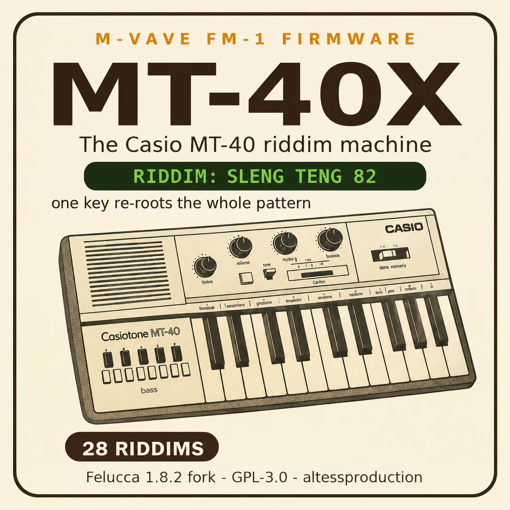

# MT-40X — le Casio MT-40/41 sur le M-VAVE FM-1



[](LICENSE)


> **MT-40X** est une fourche (fork) du firmware libre **Felucca 1.8.2** (Leo Kuroshita /
> Hügelton Instruments, GPL-3.0) qui installe dans le **M-VAVE FM-1** la machine à riddims
> du **Casio MT-40 / MT-41** : la banque de **28 riddims** de SLOOP Dub 1.6 (altessproduction),
> le **clavier de basse** du MT-40 sur les touches, le **synchro start**, deux lignes de plus
> dans MENU &gt; AUDIO. Le reste de Felucca est intact : MT-40X désarmé, votre FM-1 redevient
> un FM-1 Felucca.
>
> **Jouez-y dans le navigateur** — le vrai firmware compilé en WebAssembly :
> **<https://altessproduction.github.io/MT-40-FM1/dub/>**

---

## Sommaire

1. [L'idée — le MT-40 et le Sleng Teng](#1-lidée--le-mt-40-et-le-sleng-teng)
2. [Ce que fait MT-40X](#2-ce-que-fait-mt-40x)
3. [Emploi — pas à pas](#3-emploi--pas-à-pas)
4. [Les 28 riddims](#4-les-28-riddims)
5. [L'émulateur web](#5-lémulateur-web)
6. [Installer le firmware](#6-installer-le-firmware)
7. [L'identité FM-1_23456 et le Firmware Hub](#7-lidentité-fm-1_23456-et-le-firmware-hub)
8. [Compiler depuis les sources](#8-compiler-depuis-les-sources)
9. [Recalibrer sur une vraie MT-40](#9-recalibrer-sur-une-vraie-mt-40)
10. [La base Felucca](#10-la-base-felucca)
11. [Licences et crédits](#11-licences-et-crédits)

---

## 1. L'idée — le MT-40 et le Sleng Teng

Le **Casio MT-40** (Casiotone, début des années 1980) est un clavier d'accompagnement à
22 sons et six rythmes automatiques (Rock, Pops, Slow Rock, Swing, Waltz, Samba), avec un
clavier dédié à la basse et un synchro start. En 1984-1985, **Noel Davey** programme le
rythme *Rock* de la machine pour **Wayne Smith** : « Under Mi Sleng Teng » sort chez
**King Jammy** en 1985 et devient le premier hit du dancehall entièrement numérique — le
**Sleng Teng**, le riddim le plus versionné de l'histoire du reggae, est né du preset d'une
MT-40.

MT-40X rapporte ce fonctionnement au FM-1 tel quel : le riddim (batterie, basse, skank,
mélodie) tourne dans le séquenceur, et **le clavier re-fonde l'accompagnement en direct**,
comme la machine. Le Sleng Teng embarqué est la transcription vérifiée (l'onglet de Noel
Davey, le roll Ableton, **82 BPM**) — le *Rock* de la MT-40.

## 2. Ce que fait MT-40X

- **La banque de riddims** : les **28 riddims exactement** de SLOOP Dub 1.6
  (<https://github.com/altessproduction/sloop-dub-fm1>, étiquette v1.6), convertis pas à
  pas (chaque hit, chaque vélocité, chaque degré, chaque racine de mesure ; copie conforme
  du générateur dans `tools/sloop_riddims_data.py`). Les six rythmes de la MT-40 y sont :
  **SLENG TENG** (= Rock) plus POPS, SLOWRK, SWING, WALTZ, SAMBA.
- **Le chargement** : MENU &gt; AUDIO &gt; RIDDIM, un tour de bouton — les **quatre pistes**
  entrent aussitôt (T1 la mélodie, T2 le skank en vrais accords POLY, T3 la basse MONO,
  T4 la batterie sur le moteur DRUM) **avec le tempo du riddim** (66…172 BPM).
- **Le clavier de basse** : MT-40X armé, les **27 touches du FM-1 (MIDI 53…79, F3 à G5)**
  programment l'accompagnement au lieu de sonner :
  - **une touche** = la fondamentale, en **majeur** (sa classe de hauteur est ramenée dans
    le registre de basse, MIDI 28…50) ;
  - **la touche un demi-ton au-dessus** = la **mineur** de cette fondamentale ;
  - **deux demi-ton au-dessus** = la **septième** de cette fondamentale (la quinte de fin
    de mesure s'aplatit — le turnaround) ;
  - **la même touche deux fois** = retour au majeur de cette touche ;
  - **rien pressé** : le riddim joue **comme écrit**, ses quatre racines de mesure à lui
    (ONE DROP A-A-D-E, HEAVENLESS A-F-A-G…).
  La basse, les accords du skank et la mélodie suivent aussitôt ; **la batterie ne
  transpose jamais**.
- **SYNCHRO START** : transport arrêté et MT-40X armé, **le premier accord lancé démarre
  la lecture** — comme sur la machine.
- **Les fills sont dans le motif** (mesure 4), comme dans SLOOP Dub ; les conditions FILL
  de Felucca (**GLO + E4**) restent disponibles sur les pas que vous marquez vous-même.
- **MENU &gt; AUDIO** a deux lignes de plus : **MT-40X** (OFF/ON) et **RIDDIM** (1…28) —
  les réglages **33** et **34** du protocole éditeur web.

Les silences **tiennent** la note (TIE) et les pas marqués `cut` la **coupent** (les queues
pincées du Sleng Teng) ; c'est la notation des grilles imprimables `riddims_grids.md`.

## 3. Emploi — pas à pas

**D'abord, les gestes du MENU** — il ne s'ouvre pas tout seul, c'est le même chemin chaque
fois (les libellés sont ceux du panneau) :

| Geste | Effet |
| --- | --- |
| **HOME maintenu** (~ 1 s) | ouvre le MENU — un petit appui sur HOME le referme |
| **ALGORITHM** (la molette, en haut à droite) | change d'**onglet** : DISPLAY → CONTROL → **AUDIO** → MIDI → SYSTEM — la barre d'onglets en haut de l'écran suit la molette |
| **PRESETS** (la molette à côté) | monte / descend **ligne par ligne** dans l'onglet |
| **KNOB 1–4** (les 4 petites molettes) ou **OCT+ / OCT−** | change la **valeur** de la ligne choisie (OCT+ : valeur suivante, OCT− : valeur précédente) |

Le chemin MT-40X en clair : **HOME maintenu → ALGORITHM jusqu'à l'onglet AUDIO → PRESETS
jusqu'à la ligne MT-40X → OCT+ pour ON**. La ligne **RIDDIM** est juste en dessous.

Puis, pas à pas :

1. **Sauvegardez** vos projets, presets et échantillons (SAVE &gt; PROJECT, ou l'éditeur
   web) — la règle avant toute manipulation de firmware.
2. **Flashez** `mt40x_v1.8.2-0.3.fwsc` (voir [§6](#6-installer-le-firmware)). L'écran de
   démarrage affiche « MT-40X v1.8.2-mt40x ».
3. **MENU &gt; AUDIO &gt; RIDDIM** : sur la ligne RIDDIM, tournez **OCT+** — chaque cran
   charge le riddim (les quatre pistes, le tempo). Le nom s'affiche comme valeur de la ligne.
4. **MENU &gt; AUDIO &gt; MT-40X : ON** — remontez d'une ligne (PRESETS), OCT+ encore :
   les touches deviennent le clavier de basse.
5. **PLAY** — ou pressez une première touche : synchro start.
6. **Transposez** : une touche = majeur, +1 = mineur, +2 = septième, même touche = majeur.

| Piste | Contenu au chargement | Réglages posés |
| --- | --- | --- |
| T1 | la mélodie du riddim | GATE 127 (les silences la tiennent) |
| T2 | le skank : l'accord de la mesure (racine, tierce, quinte, + septième) | GATE 40, VOICE POLY |
| T3 | la basse : le groove au-dessus de la racine de mesure | GATE 127, VOICE MONO |
| T4 | la batterie (un hit par pas au plus, vélocités d'origine) | LEN 64, DIV 1/16 |

**Limites connues (v0.3)** : l'état MT-40X (riddim chargé, accord courant) n'est pas
sauvegardé dans le projet — rechargez après extinction (les pistes, elles, restent si vous
sauvegardez le projet) ; MT-40X armé, les touches ne sonnent pas (jouez au MIDI ou
désarmez) ; le registre du skank reste celui de la banque (57…68) ; les patterns font 4
mesures de 4/4, la VALSE de la machine est posée sur cette grille, comme dans SLOOP Dub.

## 4. Les 28 riddims

La banque, ses familles et ses sources (Studio One, le dancehall de bande et numérique, la
basse UK, les six rythmes de la machine) sont détaillées dans
**[docs/mt40x/GUIDE-RIDDIMS.md](docs/mt40x/GUIDE-RIDDIMS.md)** ; les grilles imprimables
pas à pas sont dans **`riddims_grids.md`** ; la source de vérité de la banque est
**`riddims.json`**. Table complète :

| # | Riddim | BPM | Racines (telles qu'écrites) | Référence |
| --- | --- | --- | --- | --- |
| 1 | ONE DROP | 72 | A1 A1 D2 E2 | le one drop des roots |
| 2 | STEPPERS | 76 | A2 G2 A2 G2 | quatre temps au kick |
| 3 | ROCKERS | 80 | D2 D2 A1 A1 | le rockers des Roots Radics |
| 4 | DUBWALK | 70 | A1 F2 G2 E2 | dub lent, marche de basse |
| 5 | MEDITATE | 66 | A2 G2 F2 E2 | meditation rock, très clairsemé |
| 6 | DUB CUT | 74 | A1 A1 F2 F2 | dub à trous, la basse coupée |
| 7 | ZION | 68 | D2 A1 D2 E2 | roots qui monte |
| 8 | SKA | 88 | A2 A2 F2 G2 | la marche ska |
| 9 | HEAVENLESS | 80 | A1 F2 A1 G2 | Vin Gordon, Studio One 1968 |
| 10 | TONIGHT | 84 | E2 A2 G2 E2 | Keith & Tex 1967, la basse roulante |
| 11 | GET IN GROOVE | 88 | F2 A2 G2 F2 | Studio One 1968 (Up Park Camp) |
| 12 | HOT MILK | 92 | C2 F2 G2 C2 | Jackie Mittoo 1968 |
| 13 | ANSWER | 82 | A1 A1 A1 A1 | l'accord unique, Slim Smith 1967 |
| 14 | PROMISED LAND | 78 | F2 A#2 C2 G2 | Dennis Brown 1981 (avec Aswad) |
| 15 | GUNMAN | 78 | C2 C2 G#1 A#1 | Michael Prophet 1980, la marche lourde des Roots Radics |
| 16 | HERE I COME | 95 | A1 C2 D2 E2 | Barrington Levy 1985, la pompe en octaves |
| 17 | **SLENG TENG** | 82 | C#2 ×4 | le Rock du MT-40 — Wayne Smith, King Jammy's 1985 |
| 18 | TEMPO | 88 | A1 C2 D2 A1 | Anthony Red Rose 1985, Firehouse |
| 19 | PEANY PEANY | 92 | A1 C2 A1 E2 | le rebond numérique (Fade Away) 1987 |
| 20 | DANCEHALL | 95 | A1 D2 A1 G2 | le clap 3+3+2 |
| 21 | DEMBOW | 100 | A1 A1 E2 E2 | boom-ch-boom-chick |
| 22 | JUNGLE | 172 | A1 A1 C2 G1 | les subs de la jungle |
| 23 | DUBSTEP | 140 | A1 A1 G1 G1 | le half-time, le wobble |
| 24 | MT40 POPS | 96 | E2 G2 A2 E2 | le Pops de la machine |
| 25 | MT40 SLOWRK | 66 | A1 A1 E2 D2 | le Slow Rock de la machine |
| 26 | MT40 SWING | 84 | A2 F2 G2 E2 | le Swing de la machine |
| 27 | MT40 WALTZ | 90 | A2 F#2 D2 E2 | la Valse de la machine (posée sur du 4/4) |
| 28 | MT40 SAMBA | 100 | A2 A2 G2 G2 | la Samba de la machine (l'agogo sur le rim) |

## 5. L'émulateur web

**<https://altessproduction.github.io/MT-40-FM1/dub/>** — le **vrai firmware** (Felucca
1.8.2 + MT-40X) compilé en `wasm32` freestanding (`web-emu/build.sh`, clang ou `zig cc`,
pas d'emscripten) et exécuté dans un **AudioWorklet** : le son (le mix à 44,1 kHz en
fixe), le séquenceur, les écrans (le `lcd.c`/`gfx.c` du firmware dessine chaque pixel
derrière un modèle de panneau ST7789), les LED, le clavier de basse et la banque sont le
propre code du firmware — aucune source modifiée. La façade suit la disposition de
`reference_emu/` de SLOOP Dub (knobs, boutons, clés, clavier d'ordinateur, MIDI entrée) ;
la **flash SPI est une image IndexedDB** : projets, réglages et autosave survivent au
rechargement. Sous la machine, la **console web** : l'interrupteur MT-40X, les 28 riddims
un clic, la vue des quatre pistes avec le playhead — l'état affiché est l'état du firmware.

Le smoke test livré : `node web-emu/wasm_smoke_test.js web-emu/dist/mt40x.wasm` — les
exports, le boot, la banque (28 noms, tempos), le chargement des quatre pistes, PLAY + le
chemin audio, le clavier MAJ / +1 MIN / +2 DOM7 — finit sur `AUDIO-PATH-OK`.

## 6. Installer le firmware

Le paquet d'installation est **`docs/firmware/mt40x_v1.8.2-0.3.fwsc`** (dans les assets de
la release GitHub, avec le `.bin` applicatif, les `SHA256SUMS` et les licences). Il
**inclut le loader de mise à jour** : vous pouvez toujours en ressortir, vers V15 ou vers
un autre firmware.

1. **Sauvegardez d'abord** (projets, presets, échantillons). Une installation remplace le
   firmware, pas vos données flash — mais la sauvegarde est la règle.
2. Copiez le `.fwsc` sur une clé USB (FAT32) et passez par **M-UPGRADE** sur le FM-1, ou
   flashez depuis le hub / l'installateur web. L'appareil redémarre sur
   « MT-40X v1.8.2-mt40x ».
3. Installation possible **depuis la V15 d'usine comme depuis un autre firmware** ; le
   firmware gère les deux flashes de la machine (Puya P25Q80 et UC25HQ80 des FM-1
   récents — l'apport de Felucca 1.8.2).
4. Pour ressortir : reflashez la V15 ou Felucca — le loader intégré au paquet s'en charge.

L'identité du paquet est **FM-1_23456** (voir [§7](#7-lidentité-fm-1_23456-et-le-firmware-hub)) ;
elle s'affiche dans MENU &gt; SYSTEM &gt; ABOUT et répond au protocole de mise à jour
(`ota-FM-1_23456`). Le reste de Felucca 1.8.2 est intact : moteurs, presets, projets,
éditeur web, MIDI.

## 7. L'identité FM-1_23456 et le Firmware Hub

[The Firmware Hub](https://thefirmwarehub.com/) recense les firmwares ouverts du FM-1. Un
numéro `FM-1_` n'appartient qu'à un firmware : **MT-40X est `FM-1_23456`**. Il vit à trois
endroits — la chaîne `FELUCCA_ID` du firmware (ABOUT, protocole OTA), le marqueur du
paquet `.fwsc` (ce que le hub lit), et la racine du dépôt via **`fmhub.json`** :

```json
{
  "what": "The Casio MT-40's riddim machine on the FM-1: the 28-riddim SLOOP Dub bank …",
  "author": "altessproduction",
  "kinds": ["groove"],
  "play": "https://altessproduction.github.io/MT-40-FM1/dub/",
  "cheat": "https://altessproduction.github.io/MT-40-FM1/cheat/",
  "image": "assets/mt40x-hub-card.webp",
  "color": "#E08A1E"
}
```

- **`assets/mt40x-hub-card.webp`** : la carte du hub — l'affiche rétro du MT-40X
  (carré 1024×1024, 130 Ko, sous la limite des 300 Ko du hub).
- **`docs/cheat/index.html`** : l'antisèche anglaise (clavier, 28 riddims, pistes, réglages)
  servie par Pages — le champ `cheat` du `fmhub.json`.
- **`play`** : l'émulateur web (§5), servie par Pages (branche `main`, dossier `/docs`).
- La release GitHub porte le `.fwsc` en asset et ses sources à l'étiquette — c'est ce que
  le hub relève (il relit `fmhub.json` à chaque push, la fiche se met à jour seule).

## 8. Compiler depuis les sources

```sh
git clone --recurse-submodules https://github.com/altessproduction/MT-40-FM1
cd MT-40-FM1
JIELI_TOOLCHAIN=/chemin/toolchain AC79_SDK=/chemin/fw-AC79_AIoT_SDK ./build.sh --release 0.3
```

- Prérequis et SDK : **[BUILDING.md](BUILDING.md)** (toolchain JieLi pi32v2 —
  `tools/get_toolchain.sh` — et SDK AC79 ; Pillow pour les tables générées).
- Le build produit `build/mt40x_v1.8.2-0.3.fwsc` et `build/release-0.3/` (paquet, `.bin`,
  `SHA256SUMS`, licences, attribution des échantillons).
- **La banque de riddims** : `riddims.json` est la source de vérité ;
  `python3 tools/gen_mt40_riddims.py` régénère `firmware/src/mt40_riddims.h` et les grilles
  `riddims_grids.md` (`--bootstrap` ré-extrait la banque de la copie conforme
  `tools/sloop_riddims_data.py` ; `tools/verify_bank.py` prouve la conversion champ à
  champ). Corrigez le JSON, régénérez, recompilez.
- **L'émulateur** : `sh web-emu/build.sh` (clang wasm32 ou `python3 -m ziglang cc`) —
  produit `web-emu/dist/` et rafraîchit la copie Pages `docs/dub/`.
- **Les tests** : `ui_test` (les deux variantes CPU : chargement, clavier MAJ/MIN/DOM7,
  synchro start, les deux lignes MENU), `editor_test` (réglages 33/34), `ui_render`
  (écran de démarrage, MENU 8 lignes), `regress` (98 rendus dorés), les tests
  install/OTA/loader, et le smoke test wasm (§5).

## 9. Recalibrer sur une vraie MT-40

La banque vient de SLOOP Dub, dont les riddims sont « reconstruits à la main d'après le
feel des disques » — **votre MT-40 reste l'étalon**. Le workflow complet est dans
**[docs/mt40x/CALIBRATION.md](docs/mt40x/CALIBRATION.md)** : imprimez `riddims_grids.md`,
comparez pas à pas à même tempo, corrigez `riddims.json`, régénérez, recompilez. La règle
du clavier (MAJ / MIN / DOM7, le turnaround de la septième) est le point à vérifier en
premier.

## 10. La base Felucca

Felucca est le firmware ouvert du **M-VAVE FM-1** par Leo Kuroshita (@kurogedelic) /
Hügelton Instruments : 13+ moteurs (ANALOG, FM6, DRUM…), le séquenceur à conditions, le
synthé de samples, l'éditeur web, MIDI / USB audio. Ressources en amont :

- Installateur web : <https://hugelton.github.io/Felucca/>
- Éditeur web : <https://hugelton.github.io/Felucca/webapp/editor/> (sources :
  <https://github.com/hugelton/Felucca-WebApp>)
- Manuel et notes : <https://github.com/hugelton/Felucca/wiki/Home>
- Construction : [BUILDING.md](BUILDING.md) — moteurs :
  [Felucca-Engines](https://github.com/hugelton/Felucca-Engines) (MIT), matériel :
  [felucca-bsp](https://github.com/hugelton/felucca-bsp) (MPL-2.0)

MT-40X s'appuie sur tout cela sans y toucher : moteur par moteur, preset par preset, le
FM-1 de Felucca est entier sous la machine à riddims (MENU &gt; AUDIO &gt; MT-40X : OFF).

## 11. Licences et crédits

- **Felucca** par Leo Kuroshita / Hügelton Instruments — **GPL-3.0-only**.
- **La banque de riddims** : SLOOP Dub 1.6 par altessproduction — **GPL-3.0-only**
  (`LICENSES/GPL-3.0-only-SLOOP-Dub.txt`, détails dans [LICENSING.md](LICENSING.md),
  section « The MT-40X fork »).
- **MT-40X** : contributions sous **GPL-3.0-only** — vous redistribuez avec la source
  complète.
- Casio et MT-40 sont des marques de Casio Computer Co., Ltd. MT-40X est un hommage
  indépendant, sans affiliation ni approbation de Casio ; aucune donnée de la machine
  Casio n'est incluse dans le dépôt.
